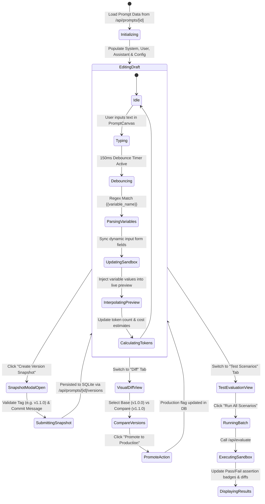

# PromptForge Studio — Technical Architecture Document

- **Document Version:** `1.0.0`
- **Status:** Approved for Implementation
- **Target Release:** MVP v1.0.0
- **System Architect:** Principal System Architect
- **Workspace:** `/Users/muttaqi/ai-engineering-team/projects/prompt-forge-saas`

---

## 1. Executive Technical Summary & Tech Stack

PromptForge Studio is an offline-first, developer-centric Prompt Engineering, Testing, and Evaluation Workbench. Designed to treat generative AI prompts as versioned, testable software assets, the architecture emphasizes zero external runtime dependencies for core workflows, sub-30ms reactive variable interpolation, deterministic multi-scenario assertions, and git-style snapshot versioning.

```
+-------------------------------------------------------------------------------------------------+
|                                       PRESENTATION TIER                                         |
|  Next.js 14 App Router | React 18 Server & Client Components | Tailwind CSS | Lucide Icons      |
+-------------------------------------------------------------------------------------------------+
                                              │
                                              ▼
+-------------------------------------------------------------------------------------------------+
|                                     APPLICATION / API TIER                                      |
|  Next.js Route Handlers (app/api/*) | Prompt Engine (Regex Parser, Tokenizer, Diff Engine)      |
|  Local Assertion & Evaluation Sandbox | SDK Code Generators (TypeScript, Python, cURL)          |
+-------------------------------------------------------------------------------------------------+
                                              │
                                              ▼
+-------------------------------------------------------------------------------------------------+
|                                    PERSISTENCE / DATA TIER                                      |
|  Prisma ORM Client | Embedded SQLite Engine (file:./prompt_forge.db) | Transactional Snapshots  |
+-------------------------------------------------------------------------------------------------+
```

### 1.1 Core Technology Stack

| Layer | Technology | Version | Rationale |
|---|---|---|---|
| **Framework** | Next.js (App Router) | `14.2+` | React Server Components for fast initial catalog rendering; Client Components for reactive split-pane studio workbench. |
| **Language** | TypeScript | `5.4+` | Strict type safety across database entities, API contracts, variable parsers, and SDK generators. |
| **Styling & Icons** | Tailwind CSS + Lucide React | `3.4+` / `0.37+` | Dark-mode-first developer aesthetic, WCAG AA compliance, rapid layout composition with accessible Radix UI primitives. |
| **Database & ORM** | SQLite via Prisma ORM | `5.14+` | Zero-dependency local persistence, atomic snapshot transactions, portable single-file database (`file:./prisma/prompt_forge.db`). |
| **API Architecture** | Next.js Route Handlers | `Next 14 App Router` | Unified RESTful API routes (`/api/prompts`, `/api/prompts/[id]`, `/api/evaluate`, `/api/prompts/[slug]/production`). |
| **State Management** | React Context + Custom Hooks | `React 18` | Centralized reactive studio state (`StudioProvider`) orchestrating prompt drafts, variable forms, and live evaluations. |
| **Evaluation Sandbox**| Local Node.js Runtime | `Node 18+` | Memory-bounded, regex and keyword assertion runner without insecure runtime script evaluation (`eval`). |

---

## 2. System Component Diagram & High-Level Architecture

### 2.1 Mermaid System Architecture Diagram

```mermaid
flowchart TD
    subgraph ClientBrowser["Client Browser (Next.js Client Components)"]
        UI_Nav["Global Navigation & Project Selector"]
        subgraph StudioWorkbench["Studio Workbench (/prompts/[id])"]
            PC["PromptCanvas (System, User, Assistant Editors)"]
            VS["VariableSandbox (Live Inputs & Presets)"]
            LP["LivePreviewPane (Interpolated Highlights)"]
            TC["TokenCostCounter (Context & Pricing Calc)"]
            VD["VisualDiffViewer (Side-by-Side Commits)"]
            TM["TestScenarioMatrix (Assertions & Batch Runner)"]
            CE["CodeExportDrawer (TS, Python, cURL)"]
        end
        StateContext["StudioContext / Local Draft State"]
    end

    subgraph APIRoutes["Next.js Route Handlers (/api/*)"]
        API_P["/api/prompts (List & Create)"]
        API_PID["/api/prompts/[id] (Read & Update)"]
        API_VER["/api/prompts/[id]/versions (Snapshot Commit)"]
        API_PRO["/api/prompts/[id]/promote (Production Toggle)"]
        API_EVAL["/api/evaluate (Deterministic Matrix Runner)"]
        API_PUB["/api/prompts/[slug]/production (SDK Integration)"]
    end

    subgraph DomainEngines["Domain Logic & Utilities (lib/*)"]
        Engine_Var["VariableParser (Regex {{var}} Detection)"]
        Engine_Tok["TokenEstimator (Model Token & Cost Rules)"]
        Engine_Diff["DiffEngine (LCS-based Text Diff)"]
        Engine_Eval["AssertionEngine (Keyword & Schema Validator)"]
        Engine_Gen["CodeGenerator (Multi-Language Snippets)"]
    end

    subgraph StorageLayer["Persistence Tier"]
        PrismaClient["Prisma Client ORM"]
        SQLiteDB[(SQLite Database prompt_forge.db)]
    end

    %% Client Interactions
    PC -->|Debounced Edit| Engine_Var
    Engine_Var -->|Extracted Keys| VS
    VS -->|Input Values| LP
    LP --> Engine_Tok
    Engine_Tok --> TC
    StudioWorkbench <--> StateContext

    %% API Connections
    StateContext -->|Fetch / Mutate| API_P
    StateContext -->|Update Draft| API_PID
    StateContext -->|Snapshot| API_VER
    StateContext -->|Promote Release| API_PRO
    StateContext -->|Run Matrix| API_EVAL
    VD -->|Compare Snapshots| API_PID

    %% Backend Execution
    API_EVAL --> Engine_Eval
    API_VER --> PrismaClient
    API_PRO --> PrismaClient
    API_PID --> PrismaClient
    API_P --> PrismaClient
    API_PUB --> PrismaClient
    PrismaClient --> SQLiteDB
```



---

## 3. Directory and File Tree Layout

```
prompt-forge-saas/
├── .env.example                               # Environment template (DATABASE_URL="file:./prompt_forge.db")
├── .gitignore
├── ARCHITECTURE.md                            # Comprehensive System Architecture Document
├── CONCEPT.md                                 # High-level product vision and requirements summary
├── PRD.md                                     # Product Requirements Document
├── README.md                                  # Developer setup and onboarding guide
├── next.config.js                             # Next.js 14 configuration
├── package.json                               # Dependencies and scripts (dev, build, prisma:seed, etc.)
├── postcss.config.js                          # PostCSS Tailwind plugins
├── tailwind.config.ts                         # Custom color palettes, monospace fonts, animations
├── tsconfig.json                              # TypeScript strict compiler options
│
├── prisma/
│   ├── prompt_forge.db                        # SQLite database file (created on prisma migrate)
│   ├── schema.prisma                          # Complete Prisma schema definition
│   └── seed.ts                                # Realistic database seeds (Support Agent, SQL Bot, Code Reviewer)
│
├── app/
│   ├── globals.css                            # Tailwind base styles and custom syntax highlight themes
│   ├── layout.tsx                             # Root layout (Metadata, Providers, Font definitions)
│   ├── page.tsx                               # Dashboard / Landing overview & prompt summary catalog
│   │
│   ├── prompts/
│   │   ├── page.tsx                           # Prompts Catalog & Filterable Table
│   │   └── [id]/
│   │       └── page.tsx                       # Main Studio Workbench (Canvas, History, Tests, Export)
│   │
│   └── api/
│       ├── prompts/
│       │   ├── route.ts                       # GET (list prompts), POST (create prompt)
│       │   ├── [id]/
│       │   │   ├── route.ts                   # GET (fetch prompt by ID), PUT (update metadata), DELETE
│       │   │   ├── versions/
│       │   │   │   └── route.ts               # POST (commit new snapshot version)
│       │   │   └── promote/
│       │   │       └── route.ts               # POST (promote or rollback active production version)
│       │   └── [slug]/
│       │       └── production/
│       │           └── route.ts               # GET (production prompt payload by slug for external SDKs)
│       │
│       ├── scenarios/
│       │   ├── route.ts                       # POST (create scenario), GET (list scenarios)
│       │   └── [id]/
│       │       └── route.ts                   # PUT (edit scenario), DELETE (remove scenario)
│       │
│       └── evaluate/
│           └── route.ts                       # POST (execute single or batch test scenario evaluation)
│
├── components/
│   ├── layout/
│   │   ├── AppHeader.tsx                      # Top bar with project selector, status, and theme toggle
│   │   ├── SidebarNav.tsx                     # Studio navigation (Prompts, Evaluations, Settings)
│   │   └── Breadcrumbs.tsx                    # Breadcrumb navigation hierarchy
│   │
│   ├── studio/
│   │   ├── PromptStudioWorkbench.tsx          # Root client container coordinating tabbed views
│   │   ├── PromptCanvas.tsx                   # Multi-role message block editor (System/User/Assistant)
│   │   ├── RoleEditorBlock.tsx                # Individual role textarea with collapsibility and badge
│   │   ├── VariableSandbox.tsx                # Auto-detected dynamic input fields sidebar
│   │   ├── LivePreviewPane.tsx                # Interpolated message viewer with parameter badges
│   │   ├── TokenCostCounter.tsx               # Context window progress bar and cost estimator
│   │   ├── VersionHistoryDrawer.tsx           # Timeline of version commits and metadata
│   │   ├── VisualDiffViewer.tsx               # Side-by-side text diffing between two chosen snapshots
│   │   ├── VersionSnapshotModal.tsx           # Modal dialog to commit tag, label, and commit message
│   │   ├── CodeExportDrawer.tsx               # Code snippet previewer with syntax copy for TS, Py, cURL
│   │   ├── TestScenarioMatrix.tsx             # Table of test cases with assertion config and status
│   │   ├── CreateScenarioModal.tsx            # Modal to add/import test scenarios and variables
│   │   └── EvaluationResultCard.tsx           # Scenario execution card with pass/fail assertion breakdown
│   │
│   └── ui/
│       ├── Button.tsx                         # Primary, secondary, danger, ghost button variants
│       ├── Input.tsx                          # Text inputs with focus rings and error states
│       ├── Textarea.tsx                       # Resizable monospace code/prompt input
│       ├── Badge.tsx                          # Status badges (Production, Passed, Failed, Version Tag)
│       ├── Modal.tsx                          # Accessible dialog wrapper with backdrop and Esc trigger
│       ├── Tabs.tsx                           # Segmented view switchers (Canvas, Diff, Tests, Export)
│       └── Toast.tsx                          # Notification banner for copies and commits
│
├── context/
│   └── StudioContext.tsx                      # Centralized React Context for current prompt draft & states
│
├── lib/
│   ├── prisma.ts                              # Singleton PrismaClient instance with hot-reload guard
│   ├── variableParser.ts                      # Regex variable extraction & template interpolation logic
│   ├── tokenEstimator.ts                      # Token estimation heuristic & multi-model pricing tables
│   ├── diffEngine.ts                          # Diff computing algorithm generating addition/deletion spans
│   ├── assertionEngine.ts                     # Deterministic rules runner (contains, forbidden, token cap)
│   ├── codeGenerators.ts                      # Formats ready-to-run TS, Python, and cURL snippets
│   └── utils.ts                               # ClassNames helper, date formatters, slug generator
│
└── types/
    ├── prompt.ts                              # Core Prompt, Version, Role, and Config type definitions
    ├── scenario.ts                            # TestScenario, InputVariables, and Assertion rule types
    ├── evaluation.ts                          # Execution result, Pass/Fail status, and Diff metrics
    └── api.ts                                 # Standard API Request and Response payload envelopes
```

---

## 4. Complete `schema.prisma` Model Specifications

The database schema utilizes SQLite for offline zero-friction execution. It models projects, canonical prompts, immutable snapshot versions, test scenarios, and evaluation run logs.

```prisma
// /prisma/schema.prisma

datasource db {
  provider = "sqlite"
  url      = env("DATABASE_URL")
}

generator client {
  provider = "prisma-client-js"
}

/// Project serves as an organizational boundary for grouping related prompts.
model Project {
  id          String   @id @default(cuid())
  name        String
  slug        String   @unique
  description String?
  prompts     Prompt[]
  createdAt   DateTime @default(now())
  updatedAt   DateTime @updatedAt

  @@index([slug])
}

/// Prompt represents the canonical prompt entity having multiple versions.
model Prompt {
  id               String          @id @default(cuid())
  projectId        String?
  project          Project?        @relation(fields: [projectId], references: [id], onDelete: Cascade)
  title            String
  slug             String          @unique
  description      String?
  activeVersionId  String?         // Reference to current active or draft version ID
  versions         PromptVersion[]
  testScenarios    TestScenario[]
  createdAt        DateTime        @default(now())
  updatedAt        DateTime        @updatedAt

  @@index([slug])
  @@index([projectId])
}

/// PromptVersion represents an immutable snapshot commit of a prompt configuration.
model PromptVersion {
  id               String             @id @default(cuid())
  promptId         String
  prompt           Prompt             @relation(fields: [promptId], references: [id], onDelete: Cascade)
  versionTag       String             // Semantic version, e.g., "v1.0.0", "v1.1.0-preview"
  commitMessage    String?            // Changelog description
  systemPrompt     String?            // Instructions for system role
  userPrompt       String             // Template with {{variable_name}} placeholders
  assistantPrompt  String?            // Optional few-shot assistant preamble
  modelConfig      String?            // Serialized JSON: { model: "gpt-4o", temperature: 0.7, maxTokens: 1024 }
  variables        String?            // Serialized JSON array of detected variable names: ["user_tier", "query"]
  isProduction     Boolean            @default(false) // Single active release per prompt
  evaluations      EvaluationResult[]
  createdAt        DateTime           @default(now())

  @@unique([promptId, versionTag])
  @@index([promptId, isProduction])
}

/// TestScenario defines input data matrices and assertion rules for testing prompts.
model TestScenario {
  id                String             @id @default(cuid())
  promptId          String
  prompt            Prompt             @relation(fields: [promptId], references: [id], onDelete: Cascade)
  name              String             // e.g., "Edge Case: Missing Invoice ID"
  inputVariables    String             // Serialized JSON: { "query": "Where is my refund?", "tier": "Gold" }
  expectedKeywords  String?            // Serialized JSON array: ["refund", "authorized"]
  forbiddenKeywords String?            // Serialized JSON array: ["unauthorized", "fatal error"]
  maxTokenLimit     Int?               // Token constraint threshold
  results           EvaluationResult[]
  createdAt         DateTime           @default(now())
  updatedAt         DateTime           @updatedAt

  @@index([promptId])
}

/// EvaluationResult records historical test execution runs and assertion passes/failures.
model EvaluationResult {
  id                  String        @id @default(cuid())
  promptVersionId     String
  promptVersion       PromptVersion @relation(fields: [promptVersionId], references: [id], onDelete: Cascade)
  scenarioId          String
  scenario            TestScenario  @relation(fields: [scenarioId], references: [id], onDelete: Cascade)
  interpolatedPrompt  String        // Rendered prompt with substituted inputs
  simulatedOutput     String        // Model output text
  status              String        // "PASSED" | "FAILED" | "ERROR"
  latencyMs           Int           // Simulated or network duration
  tokenCount          Int           // Total token count for output
  estimatedCost       Float?        // Calculated cost in USD
  failureReason       String?       // Detailed diff or reason for assertion failure
  executedAt          DateTime      @default(now())

  @@index([promptVersionId])
  @@index([scenarioId])
}
```

---

## 5. API Route Contracts & Specifications

All API routes follow standard REST conventions, returning typed JSON responses with standardized error envelopes.

### 5.1 Common Response Types

```typescript
// Standard API Envelope
export interface ApiResponse<T> {
  success: boolean;
  data?: T;
  error?: {
    code: string;
    message: string;
    details?: unknown;
  };
}
```

---

### 5.2 API Route Matrix

| Endpoint | Method | Purpose | Request Body | Response Status |
|---|---|---|---|---|
| `/api/prompts` | `GET` | List all prompts with active version & counts | Query params: `projectId`, `query` | `200 OK` |
| `/api/prompts` | `POST` | Create a new prompt and initial `v1.0.0` version | Initial prompt metadata & template | `201 Created` |
| `/api/prompts/[id]` | `GET` | Fetch prompt by ID with all versions & scenarios | None | `200 OK` / `404 Not Found` |
| `/api/prompts/[id]` | `PUT` | Update prompt title, description, or active draft | Updated prompt metadata | `200 OK` |
| `/api/prompts/[id]` | `DELETE`| Delete prompt and cascade child records | None | `200 OK` |
| `/api/prompts/[id]/versions` | `POST` | Create immutable snapshot commit | Snapshot payload & tag | `201 Created` / `409 Conflict` |
| `/api/prompts/[id]/promote` | `POST` | Mark specific version as active Production release | `{ versionId: string }` | `200 OK` |
| `/api/prompts/[slug]/production` | `GET` | External SDK dynamic prompt fetcher | None | `200 OK` / `404 Not Found` |
| `/api/evaluate` | `POST` | Execute evaluation harness for version & scenarios | Version ID and scenario IDs | `200 OK` |
| `/api/scenarios` | `POST` | Create or batch import test scenarios | Scenario payload / array | `201 Created` |

---

### 5.3 Detailed Endpoint Contracts

#### 1. `GET /api/prompts`
- **Description:** Returns an array of prompts with metadata, version counts, and active version tag.
- **Query Parameters:**
  - `query` (optional string): Text search against title and description.
- **Response Payload (`200 OK`):**
```json
{
  "success": true,
  "data": [
    {
      "id": "cm2a1b2c3d4e5",
      "title": "Customer Support Triage Agent",
      "slug": "customer-support-triage-agent",
      "description": "Categorizes inbound customer requests and suggests resolution tags.",
      "versionCount": 3,
      "scenarioCount": 6,
      "activeVersion": {
        "id": "ver_998877",
        "versionTag": "v1.2.0",
        "isProduction": true,
        "createdAt": "2026-10-16T18:00:00.000Z"
      },
      "updatedAt": "2026-10-16T18:30:00.000Z"
    }
  ]
}
```

---

#### 2. `POST /api/prompts`
- **Description:** Creates a new prompt container along with an initial `v1.0.0` version snapshot.
- **Request Body:**
```json
{
  "title": "SQL Query Optimization Expert",
  "slug": "sql-query-optimization-expert",
  "description": "Analyzes PostgreSQL EXPLAIN plans and recommends indexes.",
  "systemPrompt": "You are a senior database administrator specializing in PostgreSQL query optimization.",
  "userPrompt": "Analyze the following query and plan:\nQuery:\n{{sql_query}}\n\nExplain Output:\n{{explain_plan}}",
  "assistantPrompt": null,
  "modelConfig": {
    "model": "gpt-4o",
    "temperature": 0.2,
    "maxTokens": 2048
  }
}
```
- **Response Payload (`201 Created`):**
```json
{
  "success": true,
  "data": {
    "id": "cm2b8f9e01122",
    "title": "SQL Query Optimization Expert",
    "slug": "sql-query-optimization-expert",
    "activeVersionId": "ver_001122",
    "versions": [
      {
        "id": "ver_001122",
        "versionTag": "v1.0.0",
        "commitMessage": "Initial prompt draft",
        "isProduction": false,
        "variables": ["sql_query", "explain_plan"]
      }
    ]
  }
}
```

---

#### 3. `GET /api/prompts/[id]`
- **Description:** Retrieves the complete state of a prompt, including all historic versions, active version details, and persisted test scenarios.
- **Response Payload (`200 OK`):**
```json
{
  "success": true,
  "data": {
    "id": "cm2a1b2c3d4e5",
    "title": "Customer Support Triage Agent",
    "slug": "customer-support-triage-agent",
    "description": "Categorizes inbound customer requests.",
    "activeVersionId": "ver_998877",
    "versions": [
      {
        "id": "ver_998877",
        "versionTag": "v1.2.0",
        "commitMessage": "Added strict JSON validation requirement",
        "systemPrompt": "You are an automated support bot. Output valid JSON only.",
        "userPrompt": "Customer query: {{customer_query}}\nPriority: {{user_tier}}",
        "assistantPrompt": "{\"status\": \"acknowledged\"}",
        "modelConfig": "{\"model\":\"gpt-4o\",\"temperature\":0.3}",
        "variables": "[\"customer_query\",\"user_tier\"]",
        "isProduction": true,
        "createdAt": "2026-10-16T18:00:00.000Z"
      }
    ],
    "testScenarios": [
      {
        "id": "scen_101",
        "name": "Enterprise High-Priority Refund",
        "inputVariables": "{\"customer_query\":\"System down and demanding full refund\",\"user_tier\":\"Enterprise\"}",
        "expectedKeywords": "[\"refund\",\"escalation\"]",
        "forbiddenKeywords": "[\"unsupported\"]",
        "maxTokenLimit": 500
      }
    ]
  }
}
```

---

#### 4. `POST /api/prompts/[id]/versions`
- **Description:** Commits a new immutable snapshot version.
- **Request Body:**
```json
{
  "versionTag": "v1.3.0",
  "commitMessage": "Expanded few-shot examples for edge cases",
  "systemPrompt": "You are an automated support bot. Output valid JSON only.",
  "userPrompt": "Customer query: {{customer_query}}\nTier: {{user_tier}}\nLocale: {{locale}}",
  "assistantPrompt": "{\"status\": \"acknowledged\"}",
  "modelConfig": {
    "model": "gpt-4o",
    "temperature": 0.2
  },
  "isProduction": false
}
```
- **Error Response (Duplicate Tag `409 Conflict`):**
```json
{
  "success": false,
  "error": {
    "code": "DUPLICATE_VERSION_TAG",
    "message": "Version tag 'v1.3.0' already exists for this prompt."
  }
}
```

---

#### 5. `POST /api/prompts/[id]/promote`
- **Description:** Atomically promotes a specified version to `isProduction = true`, resetting all other versions of that prompt to `false` via a database transaction.
- **Request Body:**
```json
{
  "versionId": "ver_998877"
}
```
- **Response Payload (`200 OK`):**
```json
{
  "success": true,
  "data": {
    "promptId": "cm2a1b2c3d4e5",
    "promotedVersionId": "ver_998877",
    "versionTag": "v1.2.0",
    "isProduction": true,
    "promotedAt": "2026-10-16T19:00:00.000Z"
  }
}
```

---

#### 6. `GET /api/prompts/[slug]/production`
- **Description:** Lightweight endpoint consumed by backend microservices and integration SDKs to dynamically retrieve the active production prompt template.
- **Response Payload (`200 OK`):**
```json
{
  "slug": "customer-support-triage-agent",
  "version": "v1.2.0",
  "systemPrompt": "You are an automated support bot. Output valid JSON only.",
  "userPrompt": "Customer query: {{customer_query}}\nPriority: {{user_tier}}",
  "assistantPrompt": "{\"status\": \"acknowledged\"}",
  "variables": ["customer_query", "user_tier"],
  "modelConfig": {
    "model": "gpt-4o",
    "temperature": 0.3
  },
  "updatedAt": "2026-10-16T19:00:00.000Z"
}
```

---

#### 7. `POST /api/evaluate`
- **Description:** Executes test scenarios against a prompt version, generating outputs and running assertion tests.
- **Request Body:**
```json
{
  "promptVersionId": "ver_998877",
  "scenarioIds": ["scen_101", "scen_102"]
}
```
- **Response Payload (`200 OK`):**
```json
{
  "success": true,
  "data": {
    "batchSummary": {
      "total": 2,
      "passed": 1,
      "failed": 1,
      "durationMs": 420
    },
    "results": [
      {
        "id": "eval_501",
        "scenarioId": "scen_101",
        "scenarioName": "Enterprise High-Priority Refund",
        "status": "PASSED",
        "latencyMs": 195,
        "tokenCount": 84,
        "simulatedOutput": "{\"category\": \"billing\", \"priority\": \"escalation\", \"refund_eligible\": true}",
        "assertions": [
          { "rule": "contains 'refund'", "passed": true },
          { "rule": "contains 'escalation'", "passed": true },
          { "rule": "maxTokens <= 500", "passed": true }
        ],
        "failureReason": null
      },
      {
        "id": "eval_502",
        "scenarioId": "scen_102",
        "scenarioName": "Spam / Non-Query Filter",
        "status": "FAILED",
        "latencyMs": 225,
        "tokenCount": 42,
        "simulatedOutput": "Hello, thank you for contacting us today.",
        "assertions": [
          { "rule": "contains 'ignore'", "passed": false },
          { "rule": "forbidden 'thank you'", "passed": false }
        ],
        "failureReason": "Missing required keyword 'ignore'; Found forbidden keyword 'thank you'"
      }
    ]
  }
}
```

---

## 6. Frontend Component Hierarchy & State Flow

### 6.1 Component Hierarchy Tree

```
app/layout.tsx (Root HTML, Inter & JetBrains Mono Fonts, ToastContainer)
└── app/prompts/[id]/page.tsx (Prompt Studio Route)
    └── StudioProvider (Context wrapping active prompt draft, versions, scenarios)
        ├── AppHeader (Project badge, Breadcrumbs, Save Snapshot Trigger, Release Badge)
        └── PromptStudioWorkbench (Main Workspace Tabs)
            ├── [Tab 1: Canvas & Sandbox]
            │   ├── SplitPaneContainer
            │   │   ├── Left Pane: PromptCanvas
            │   │   │   ├── RoleEditorBlock (System Instructions)
            │   │   │   ├── RoleEditorBlock (User Template with {{vars}})
            │   │   │   └── RoleEditorBlock (Optional Assistant Preamble)
            │   │   └── Right Pane: Sandbox & Preview
            │   │       ├── VariableSandbox (Dynamic input fields generated from regex)
            │   │       ├── LivePreviewPane (Interpolated text with highlighted variables)
            │   │       └── TokenCostCounter (Token estimation & price calculator)
            │
            ├── [Tab 2: History & Visual Diff]
            │   ├── VersionHistoryDrawer (List of commits, semantic tags, authors)
            │   └── VisualDiffViewer
            │       ├── DiffSelectorBar (Base version vs. Compare version dropdowns)
            │       ├── SideBySideDiffView (Highlighted additions & deletions)
            │       └── PromoteToProductionAction (1-click active release toggle)
            │
            ├── [Tab 3: Test Scenarios & Evals]
            │   ├── TestScenarioMatrix
            │   │   ├── ScenariosHeader (Batch "Run All" trigger, Add Scenario modal)
            │   │   ├── ScenarioTableRow (Inputs, assertions, status badge)
            │   │   └── EvaluationResultCard (Output inspector, assertion breakdown)
            │
            └── [Tab 4: Code Export & API]
                └── CodeExportDrawer
                    ├── LanguageTabs (TypeScript / OpenAI, Python, cURL, Dynamic API)
                    ├── SyntaxHighlighter (Monospace preview with copy button)
                    └── ProductionEndpointCard (Live GET /api/prompts/[slug]/production)
```

---

### 6.2 Client State Flow & Lifecycle



---

## 7. Core Engine Algorithms & Implementation Details

### 7.1 Dynamic Variable Parser & Interpolation

The variable parser runs in browser memory on every keystroke (debounced at 150ms). It extracts all unique parameter keys matching the pattern `/\{\{\s*([a-zA-Z0-9_]+)\s*\}\}/g` and provides safe HTML/React rendering of replaced text.

```typescript
// /lib/variableParser.ts

export const VARIABLE_REGEX = /\{\{\s*([a-zA-Z0-9_]+)\s*\}\}/g;

/**
 * Extracts unique variable names from prompt templates.
 */
export function extractVariables(templates: (string | null | undefined)[]): string[] {
  const variableSet = new Set<string>();
  
  templates.forEach((template) => {
    if (!template) return;
    let match: RegExpExecArray | null;
    const regex = new RegExp(VARIABLE_REGEX);
    while ((match = regex.exec(template)) !== null) {
      if (match[1]) {
        variableSet.add(match[1].trim());
      }
    }
  });

  return Array.from(variableSet);
}

/**
 * Interpolates variables into a template safely.
 */
export function interpolateTemplate(
  template: string,
  variables: Record<string, string>
): string {
  if (!template) return "";
  return template.replace(VARIABLE_REGEX, (_, varName) => {
    return variables[varName] !== undefined ? variables[varName] : `{{${varName}}}`;
  });
}
```

---

### 7.2 Token & Cost Estimation Engine

Provides instant token calculations without requiring external tokenizer network calls, calibrated for OpenAI, Anthropic, and Gemini standard byte-pair encodings.

```typescript
// /lib/tokenEstimator.ts

export interface ModelPricing {
  modelName: string;
  inputPer1k: number;  // Cost per 1,000 input tokens in USD
  outputPer1k: number; // Cost per 1,000 output tokens in USD
  maxContext: number;  // Max context tokens
}

export const MODEL_CATALOG: Record<string, ModelPricing> = {
  "gpt-4o": {
    modelName: "GPT-4o (Omni)",
    inputPer1k: 0.005,
    outputPer1k: 0.015,
    maxContext: 128000
  },
  "claude-3-5-sonnet": {
    modelName: "Claude 3.5 Sonnet",
    inputPer1k: 0.003,
    outputPer1k: 0.015,
    maxContext: 200000
  },
  "gemini-1-5-pro": {
    modelName: "Gemini 1.5 Pro",
    inputPer1k: 0.0035,
    outputPer1k: 0.0105,
    maxContext: 1000000
  }
};

/**
 * Estimates token count based on standard English and code heuristic (~4 chars per token).
 */
export function estimateTokens(text: string): number {
  if (!text) return 0;
  // Standard approximation: ~3.8 characters per token including whitespace and punctuation
  return Math.ceil(text.length / 3.8);
}

/**
 * Computes projected cost for prompt input and simulated output.
 */
export function calculateEstimatedCost(
  inputTokens: number,
  outputTokens: number,
  modelKey: string = "gpt-4o"
): { inputCost: number; outputCost: number; totalCost: number } {
  const model = MODEL_CATALOG[modelKey] || MODEL_CATALOG["gpt-4o"];
  const inputCost = (inputTokens / 1000) * model.inputPer1k;
  const outputCost = (outputTokens / 1000) * model.outputPer1k;
  return {
    inputCost,
    outputCost,
    totalCost: inputCost + outputCost
  };
}
```

---

### 7.3 Deterministic Assertion Evaluation Sandbox

The evaluation sandbox evaluates test scenarios deterministically in a local memory-bounded execution loop without using dangerous `eval()` calls.

```typescript
// /lib/assertionEngine.ts

export interface AssertionRuleSet {
  expectedKeywords?: string[];
  forbiddenKeywords?: string[];
  maxTokenLimit?: number;
}

export interface AssertionCheckResult {
  ruleName: string;
  passed: boolean;
  message: string;
}

export interface EvaluationOutcome {
  status: "PASSED" | "FAILED";
  assertions: AssertionCheckResult[];
  failureSummary?: string;
}

export function evaluateAssertions(
  output: string,
  outputTokenCount: number,
  rules: AssertionRuleSet
): EvaluationOutcome {
  const assertions: AssertionCheckResult[] = [];
  let allPassed = true;
  const lowerOutput = output.toLowerCase();

  // 1. Required Keywords Check
  if (rules.expectedKeywords && rules.expectedKeywords.length > 0) {
    rules.expectedKeywords.forEach((keyword) => {
      const exists = lowerOutput.includes(keyword.toLowerCase());
      assertions.push({
        ruleName: `Contains keyword: "${keyword}"`,
        passed: exists,
        message: exists
          ? `Found required keyword "${keyword}"`
          : `Missing required keyword "${keyword}"`
      });
      if (!exists) allPassed = false;
    });
  }

  // 2. Forbidden Keywords Check
  if (rules.forbiddenKeywords && rules.forbiddenKeywords.length > 0) {
    rules.forbiddenKeywords.forEach((forbidden) => {
      const exists = lowerOutput.includes(forbidden.toLowerCase());
      assertions.push({
        ruleName: `Excludes keyword: "${forbidden}"`,
        passed: !exists,
        message: !exists
          ? `Verified absence of "${forbidden}"`
          : `Detected forbidden keyword "${forbidden}"`
      });
      if (exists) allPassed = false;
    });
  }

  // 3. Max Token Limit Check
  if (rules.maxTokenLimit && rules.maxTokenLimit > 0) {
    const withinLimit = outputTokenCount <= rules.maxTokenLimit;
    assertions.push({
      ruleName: `Token count <= ${rules.maxTokenLimit}`,
      passed: withinLimit,
      message: withinLimit
        ? `Output token count (${outputTokenCount}) is within limit`
        : `Output exceeded token limit (${outputTokenCount} > ${rules.maxTokenLimit})`
    });
    if (!withinLimit) allPassed = false;
  }

  const failures = assertions.filter((a) => !a.passed).map((a) => a.message);

  return {
    status: allPassed ? "PASSED" : "FAILED",
    assertions,
    failureSummary: failures.length > 0 ? failures.join("; ") : undefined
  };
}
```

---

## 8. Integration Code Export Specifications

The studio exports ready-to-paste integration snippets in TypeScript, Python, and cURL, interpolating variables or parameterizing them into SDK function arguments.

### 8.1 TypeScript (OpenAI SDK) Generator Output Example

```typescript
import OpenAI from "openai";

const openai = new OpenAI();

interface CustomerSupportTriageAgentParams {
  customer_query: string;
  user_tier: string;
}

export async function runCustomerSupportTriageAgent(params: CustomerSupportTriageAgentParams) {
  const response = await openai.chat.completions.create({
    model: "gpt-4o",
    temperature: 0.3,
    messages: [
      {
        role: "system",
        content: "You are an automated support bot. Output valid JSON only."
      },
      {
        role: "user",
        content: `Customer query: ${params.customer_query}\nPriority: ${params.user_tier}`
      }
    ]
  });

  return response.choices[0].message.content;
}
```

### 8.2 Python (OpenAI SDK) Generator Output Example

```python
import os
from openai import OpenAI

client = OpenAI(api_key=os.environ.get("OPENAI_API_KEY"))

def run_customer_support_triage_agent(customer_query: str, user_tier: str) -> str:
    response = client.chat.completions.create(
        model="gpt-4o",
        temperature=0.3,
        messages=[
            {
                "role": "system",
                "content": "You are an automated support bot. Output valid JSON only."
            },
            {
                "role": "user",
                "content": f"Customer query: {customer_query}\nPriority: {user_tier}"
            }
        ]
    )
    return response.choices[0].message.content
```

### 8.3 cURL Integration Snippet

```bash
curl https://api.openai.com/v1/chat/completions \
  -H "Content-Type: application/json" \
  -H "Authorization: Bearer $OPENAI_API_KEY" \
  -d '{
    "model": "gpt-4o",
    "temperature": 0.3,
    "messages": [
      {
        "role": "system",
        "content": "You are an automated support bot. Output valid JSON only."
      },
      {
        "role": "user",
        "content": "Customer query: Where is my invoice?\nPriority: Platinum"
      }
    ]
  }'
```

---

## 9. Security, Data Integrity & Performance Strategy

### 9.1 Data Integrity with Prisma Transactions
When promoting a prompt version to production, race conditions or duplicate production flags must be prevented. All version promotions execute within atomic transactions:

```typescript
// Atomic Promotion Transaction
await prisma.$transaction(async (tx) => {
  // Step 1: Remove production flag from all versions of this prompt
  await tx.promptVersion.updateMany({
    where: { promptId: id },
    data: { isProduction: false }
  });

  // Step 2: Set target version as production
  await tx.promptVersion.update({
    where: { id: targetVersionId },
    data: { isProduction: true }
  });

  // Step 3: Update prompt canonical activeVersion pointer
  await tx.prompt.update({
    where: { id },
    data: { activeVersionId: targetVersionId }
  });
});
```

### 9.2 Input Sanitization & XSS Safeguards
- All interpolated variable previews are rendered through standard React DOM escaping, preventing arbitrary script injection from simulated inputs or malicious variables.
- Raw HTML rendering is strictly prohibited in the preview panes.

### 9.3 Zero Cloud Runtime Lock-In
- The entire system operates without mandatory external cloud services.
- The evaluation sandbox contains a deterministic mock generator for offline test verification while supporting user-supplied API keys when live cloud LLM testing is activated.
